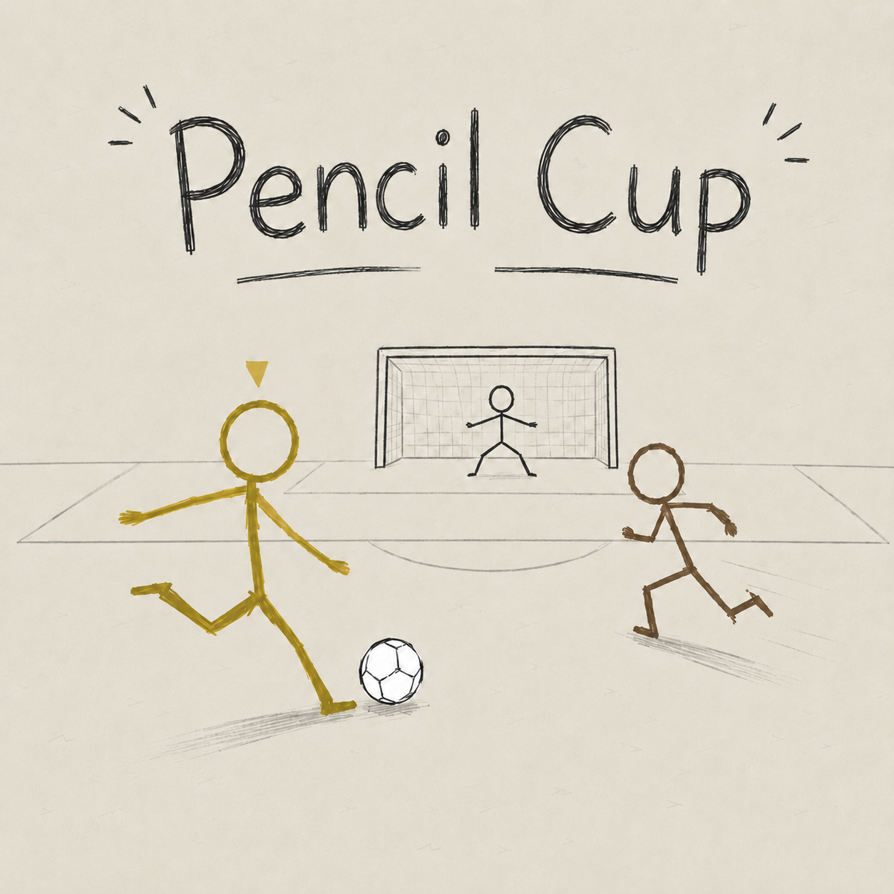
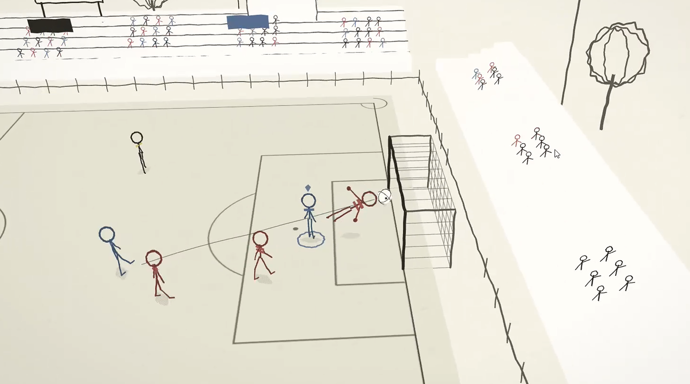
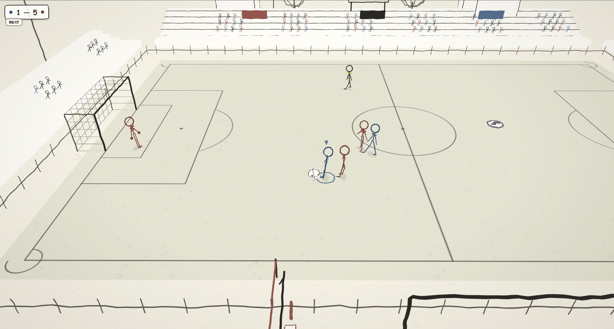
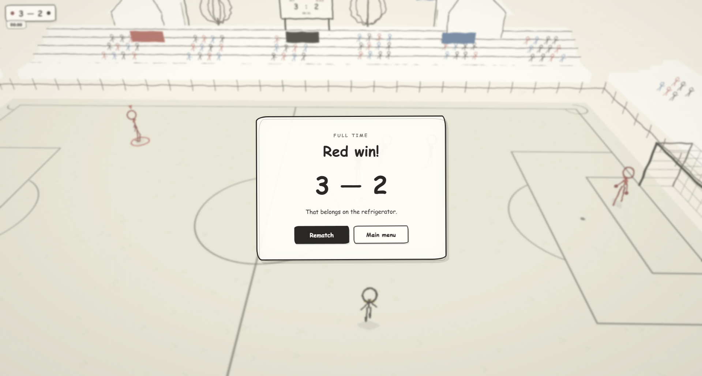

# Pencil Cup

A hand-drawn 3v3 arcade football game set in a pencil world. Two human or AI sides contest short matches with passing, shooting, possession changes, goalkeeping, set pieces, replays, and a lightweight tournament structure.

**Links:** [Play on itch.io](https://abprojects.itch.io/pencil-cup) · [Technical report (PDF)](docs/TECHNICAL_REPORT.pdf) · [Technical report (Markdown)](docs/TECHNICAL_REPORT.md) · [Architecture diagram](docs/ARCHITECTURE.png)

## Gallery

Original images from the [official itch.io game page](https://abprojects.itch.io/pencil-cup):

## What the game contains

- **3v3 football loop:** short matches with manual control, AI teammates and opponents, possession, tackles, goalkeeper calls, and goals.
- **Multiple play modes:** friendly play, quick matches, and the Pencil Cup flow.
- **Fixed-step simulation:** the match state advances at 120 Hz for more stable gameplay behavior across display frame rates.
- **Presentation systems:** replay, score HUD, pause/results screens, quality settings, and legibility options.
- **Self-contained distribution:** the playable build remains one `index.html` with embedded runtime code and assets.

## Controls

- **Move:** `W A S D`
- **Sprint:** `Shift`
- **Pause:** `P`
- **With the ball:** `Left Mouse` pass, hold `Left Mouse` to shoot, `Right Mouse` to loft the ball.
- **Without the ball:** `Left Mouse` chase or tackle, `Right Mouse` switch player or call the goalkeeper.

## Run locally

Open **`index.html`** in a modern desktop browser with WebGL support. The same file can be uploaded to itch.io as an HTML5 project so long as `index.html` stays at the ZIP root.

## Repository contents

- `index.html` — the entire playable game. No runtime dependency is split into extra source files.
- `docs/TECHNICAL_REPORT.pdf` — formal engineering report.
- `docs/TECHNICAL_REPORT.md` — GitHub-readable source of the report.
- `docs/ARCHITECTURE.png` / `docs/ARCHITECTURE.dot` — subsystem diagram.
- `docs/itch-gallery/` — the original itch.io gallery, with image-source records.
- `docs/RELEASE_NOTES.md` — exact change summary for this maintenance pass.
- `docs/VALIDATION.md` — browser acceptance checklist.
- `docs/RELEASE_MANIFEST.json` — source/release hashes and release metadata.
- `tests/verify.mjs` — self-contained packaging and syntax smoke checks.

## Maintenance changes in this release

This maintenance pass does **not** redesign the game or split it into modules. The main behavior change is an **idle-render governor**: hidden tabs skip rendering and non-gameplay views render at most 10 times per second. Active match simulation, controls, football rules, physics parameters, and bundled dependencies remain on their original path.

## Verification status

- JavaScript syntax and packaging checks pass.
- A WebGL-capable Chromium session reached menu and kickoff states without uncaught JavaScript errors.
- Manual browser playtesting is still required before any production republish.

## Notes on visuals and ownership

The images in `docs/itch-gallery/` were downloaded from the official itch.io game page; their exact source URLs and SHA-256 checksums are in `docs/ITCH_GALLERY_SOURCES.json`. No fabricated marketing images were created. Third-party embedded engine/runtime notices remain in the shipped source. No additional repository-wide licence has been selected here.
