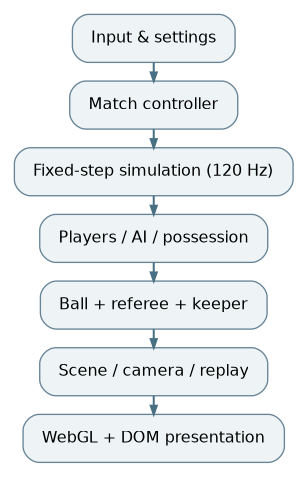
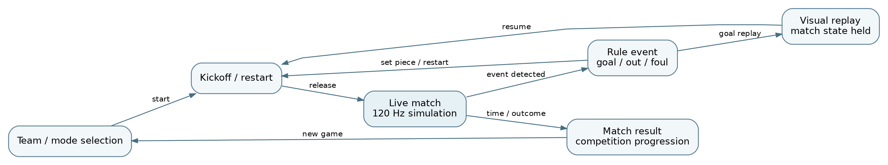

# Pencil Cup: A Self-Contained 3D Arcade Football System

**ABProjects · System Design and Implementation Report · October 2026**

## Abstract

**Pencil Cup** is a self-contained, three-dimensional arcade football game in which two three-player teams compete on a hand-drawn pitch. Its browser runtime combines a fixed-step match simulation, player and teammate controllers, autonomous opposition, ball and possession mechanics, goalkeeping, set-piece handling, instant replays, and a WebGL scene with a DOM-based interface. This report describes the delivered program rather than a proposed design. In particular, it examines how football state, visual state, and browser input are kept distinct within a single HTML distribution file; why the simulation uses a bounded 120 Hz update loop; how ball trajectories and possession decisions interact with AI and match rules; and how rendering quality and background-state handling affect resource use. The analyzed release includes a conservative idle-render gate that suppresses hidden-tab draws and limits non-gameplay presentation to approximately ten draws per second without changing the active simulation. Validation consists of source and syntax inspection, a runnable JavaScript integrity check, and targeted browser smoke observations. The available measurements concern rendering submissions in an instrumented idle-state test, not end-to-end frame rate or gameplay accuracy. The account separates verified behavior from features that still require complete human-controlled match testing.

**Index terms—** browser games; fixed-timestep simulation; arcade football; player control; game AI; WebGL; replay; performance engineering.

## I. Introduction

A football game must manage several distinct types of state at once. A ball can move freely, bounce, be kicked, or become effectively controlled by a player. Human input coexists with autonomous teammates and opponents. Goals, kickoff ownership, fouls, and set pieces must agree with the visible action, while pause and replay must not accidentally advance the official match clock. On the browser side, animation-frame callbacks have variable intervals even when game rules require stable numerical steps. Pencil Cup addresses these concerns inside one HTML5 application with a stylized 3D renderer and an overlay-based interface.

The project deliberately favors fast, legible three-versus-three matches over the complexity of a fully realistic football simulator. Its playable modes include friendly play, a quick match, and the Pencil Cup competition. The computer-controlled participants use the same match-state objects as the human player; they are not simulated on a server or through an external service. All runtime CSS, program logic, graphical dependencies, and authored assets are embedded in the browser document. This is a distribution choice: the repository can still contain technical documentation and test scripts, but the running game remains a single file.

The principal engineering problem is coordination. A fixed-rate physics model must make progress independently of the monitor's refresh rate, a variable-rate camera must follow that model, and menu or result screens must remain responsive even when full 3D presentation is unnecessary. This report therefore concentrates on state ownership, numerical integration, player and AI interaction, replay and match transitions, and defensible performance claims. It does not treat comments, aesthetics, or a code-formatting pass as substitutes for those properties.

## II. System and game model

### A. Components and state ownership

The runtime consists of a match controller, input abstraction, match/ball/player models, AI logic, presentation controllers, and Three.js-based scene infrastructure. The match controller owns the current mode and phase, controlled player, teams and score, possession references, referee state, and presentation triggers. Ball and player objects maintain their own kinematic state. Camera, audio, HUD, and replay consumers observe the match and scene states. This division is conceptual: the distributed build embeds those systems in one document instead of importing many files.

A user action is not itself a rule outcome. An input event may request a shot; the current phase and possession logic determine whether a shot is valid and which ball state changes. The controller then publishes updated positions, score and phase information for scene transforms and DOM overlays. This ordering prevents the display from becoming an independent source of match truth.

### B. Visible rules and interaction

The authored controls distinguish possession and non-possession actions. With the ball, the left mouse button performs a pass or charges a shot and the right button selects a lofted action. Without possession, equivalent buttons chase/tackle or switch the controlled player and request goalkeeper behavior. WASD movement, Shift sprint and P pause remain constant. This state-dependent mapping keeps the control surface compact, but imposes a correctness requirement: phase and possession must be resolved before interpreting an action.

The HUD presents score, clock, role and contextual feedback. Menus expose mode, team and settings selections. Pause, confirmation, replay, match introduction and result panels are explicit presentation states. The interface is layered over one WebGL canvas; text and buttons are DOM elements, not independent 3D meshes.

## III. Fixed-rate simulation

### A. Accumulator scheduling

The match source defines a fixed simulation step of $h=1/120$ second and a maximum of fourteen simulation steps in one visual callback. Let $d_n$ denote the elapsed wall-clock interval received with callback $n$, and $a_n$ the unconsumed simulation time. The underlying update pattern is equivalent to

$$
\widetilde a_n = \min(a_{n-1}+\min(d_n,0.1),14h),
$$

$$
N_n=\min\left(14,\left\lfloor\frac{\widetilde a_n}{h}\right\rfloor\right).
$$

$$
a_n = \widetilde a_n-N_nh.
$$

The bounded accumulator constrains the maximum work following a browser stall. The upper bound also means a long suspension does not produce a full real-time catch-up; the game intentionally trades elapsed-time fidelity for smoothness and bounded CPU work. This is appropriate for an arcade match but needs to be understood when interpreting match-clock behavior.

The physics-step size is independent of the current monitor refresh rate. On a nominal 60 Hz display with regular frame arrivals, two fixed updates usually occur per display callback; on a 120 Hz display, approximately one. Fixed-step integration reduces sensitivity to variable display cadence, but does not establish deterministic replay by itself: input sampling time, random initialization, floating-point environment, and game-phase transitions also influence results.

### B. Ball kinematics and events

The ball model tracks position and velocity in world coordinates and responds to gravity, impacts, possession and deliberate kicks. The authored gravity parameter is $g=21.5$ world units per square second, the ball radius is $0.31$ world units, and the ground bounce factor is $0.56$. Ignoring impacts and drag over a short free-flight interval, a kick beginning with position $\mathbf p_0$ and velocity $\mathbf v_0$ follows the familiar discrete model

$$
\mathbf v_{k+1}=\mathbf v_k+h\mathbf g,\qquad
\mathbf p_{k+1}=\mathbf p_k+h\mathbf v_{k+1},
$$

where $\mathbf g$ acts downward. This equation describes the integration idea, not a claim that every collision branch implements precisely this update order. Wall, post, net, floor and controlled-dribble transitions require additional response rules. A bounce coefficient acts on the impact-normal component of velocity; treating every collision as a simple full-vector reversal would create visibly incorrect energy gain and lateral motion.

Passing and shooting share ball-state updates but differ in target selection and charging. The code also includes a shot projection estimate used to reason about whether a predicted trajectory intersects the goal mouth. That computation is conditional: defenders and goalkeepers can still change the trajectory after the prediction. Collision and possession systems must therefore reconcile *predicted* action quality with *actual* events.

### C. Player motion and possession

Controlled players and AI participants have world-space position and velocity or movement intentions. Sprint, active selection and contextual movement affect behavior. Possession is represented through an owner reference; a dribble update can move the ball with that player, while a kick transitions it back toward free movement. The program exposes explicit logic such as `applyDribbling`, `handleAutoSwitch`, and possession-owner assignment. These concepts are crucial: if a released ball still retained its previous dribble owner, it could be pulled back toward the player in later frames; if two players simultaneously became owners, interaction would become inconsistent.

An important invariant is that score and possession do not depend on the number of visual frames. A visible goal should arise from the simulation's boundary/event checks, after which a referee or match-phase transition changes control availability and the next kickoff. This separation makes it possible to adjust renderer resolution without changing ball trajectories.

## IV. Team behavior and game rules

### A. Autonomous teammates and opponents

A three-player game cannot require the user to control all players directly. Each autonomous player needs movement goals that agree with the current ball phase: support the possessor, recover defensively, create or block passing lanes, or pursue a loose ball. The same simulation state is observed by human and AI controllers; the AI contributes movement/action requests, rather than owning a second ball or independent match clock. This limits synchronization problems but creates tactical design trade-offs: decisions that are too frequent waste CPU and cause jitter, while infrequent decisions leave defenders visibly late.

The analyzed build has no evidence of server-side inference or a separately trained neural model for football tactics. Describing its opponent logic as an external machine-learning service would therefore be inaccurate. It is application-defined autonomous logic operating inside the local game loop. The source includes role and teammate behavior, switching and support decisions, and keeper actions; this report does not invent quantitative AI-performance benchmarks.

### B. Goalkeeping and referee phases

The goalkeeper differs from a field player because position, ball-interception decisions and keeper-specific calls matter around the goal mouth. Referee and set-piece logic give match events an ordering: detect a condition, enter an appropriate phase, restrict permitted actions, place the ball and participating players, then release control at restart. Relevant presentation includes kickoff aiming and set-piece trajectory aids. Failure to guard these transitions can cause double goals, illegal shots during a restart, or a phase that never becomes playable.

Cup mode extends the single-match model with a competition-level progression layer. Match outcome must be committed before advancing the bracket or result state. Friendly and quick modes reuse the same core mechanics but differ in their setup and continuation flows. Because these modes reuse the match model, testing should cover one completed game in each path rather than verifying only the menu buttons.

### C. Replay and view-state isolation

Replay stores samples of previous simulated events for later presentation. During playback, the scene can temporarily use recorded transforms and camera instructions rather than reading the current ordinary match pose. The critical distinction is between a *replayed display state* and the authoritative current match state. A replay should not cause extra physics steps, award another goal, or overwrite the state that will be resumed. A separate replay-completion transition restores the ordinary scene and HUD. This distinction also explains why `pause`, `replay` and `interstitial` cannot be modeled as synonyms.

### D. Timing, control, and scoring invariants

Several invariants make the football simulation reviewable. A match score is incremented by a recognized scoring event, not by re-entering the visual replay. Possession has at most one current owner. A kickoff, free kick or other restart is not valid ordinary open play until the rule controller releases it. The simulated ball remains within a consistent coordinate system, so player movement, goal geometry and camera framing agree about what happened. A controller can change which player is selected without teleporting the ball or creating another participant. These invariants are more useful for regression testing than a visual assertion that “the game looked normal.”

A targeted test of an ordinary goal should record the ball's last legal position, crossing of the goal plane, phase transition, score change, replay entry, replay exit and restart possession. The expected result is one increment and one restart. Repeating the same test at different screen resolutions helps establish that GPU scaling does not influence match rules. A second test should interrupt a charged shot with pause or a rule transition and check that no queued shot is fired after the mode changes. These tests can be implemented as trace hooks inside the single document without adding new runtime modules.

The runtime's update structure makes it possible to distinguish a late visual frame from a late physics step. When a draw is delayed but the accumulator still processes several permitted fixed steps, the ball simulation may advance normally while presentation temporarily appears less smooth. A monitor with higher refresh rate makes the motion easier to see but does not automatically make the model's integration finer than 120 Hz. Conversely, CPU saturation that exhausts the fourteen-step cap can cause the simulated game to diverge from real elapsed time. This is a deliberate limit and should be reported, not silently “fixed” by increasing the catch-up budget without tests.

### E. Component complexity and test budget

The per-step cost can be divided into player controls, AI decisions, ball contacts and phase/rule checks. With six active players, participant count is small and fixed, so these computations are ordinarily bounded at one match's scale. Rendering has different characteristics: geometry, shadows and fragments are affected by effective pixel count and draw calls. Replays also require a finite buffer of captured poses. An indiscriminate performance optimization that caches every display state could increase memory use without reducing physics cost. The useful profiling question is therefore which subsystem dominates in *active play*, in *replay*, and in *paused UI*, rather than whether the whole HTML file has many lines.

A reproducible performance comparison should control game mode, difficulty, display dimensions, browser version, quality tier, active match phase and input route. It should record both frame callback intervals and expensive operations per fixed step. Testing only in a menu can identify idle rendering waste but cannot establish a match-time speedup. This distinction explains the conservative scope of the measured release improvement.

## V. Rendering and interface design

### A. Graphical pipeline

The browser uses a Three.js renderer, a perspective camera and stylized geometry, with DOM overlays for controls and information. A world update produces transforms for players, ball, stadium and presentation effects. The camera and animations consume the current world state, and the renderer submits the resulting scene to WebGL. The visual style combines paper-toned backgrounds and sketched UI elements with scene geometry.

The renderer has user-facing quality tiers and caps device pixel ratio. The examined settings include a low cap of $1$, a default cap near $1.8$, and a high cap of $2$, in addition to the device's own reported ratio. For a canvas of logical dimensions $W\times H$ and effective pixel ratio $r$, the backing target may require approximately

$$
P = (Wr)(Hr)=WHr^2
$$

pixels before overdraw, shading, postprocessing and other effects. Doubling $r$ can quadruple the pixel count. A resolution setting can therefore dominate fragment workload even when physics and AI calculations are unchanged. The trade-off is controlled by the user instead of by altering game mechanics.

### B. Display state versus simulation state

An active match needs frequent scene updates for motion feedback. A settings screen showing a nearly static backdrop does not have the same need. The revised build introduces an idle-render gate after the controller's update and input handling: during active simulation, rendering follows the normal animation callback; in a menu or other non-gameplay view, scene draws are limited to approximately ten per second; while the document is hidden, WebGL draws are skipped. The animation callback itself continues, so control and interface transitions are not delayed by a wholesale reduction in event processing.

The gate does not change ball integrator settings, player actions, AI or elapsed game time. Its scope is reduced unnecessary drawing, not active-play acceleration. In particular, frame request counts are not identical to measured GPU time, and the existence of a throttle does not guarantee lower energy use in every browser or hardware configuration.

## VI. Implementation and verification

### A. Packaging and software boundaries

The delivered program is one HTML file containing compiled CSS and bundled JavaScript. Its large JavaScript portion includes the rendering engine, so widespread beautification of identifiers would turn a small change into a large opaque diff. The repository deliberately leaves this distribution artifact intact; tests, diagrams and documents live beside it and are not runtime imports. No external network requirement was observed for ordinary game initialization in the examined release.

The source-level maintenance change is narrow enough to compare against an original checksum recorded in `docs/RELEASE_MANIFEST.json`. The manifest is a traceability aid, not proof of semantic equivalence. For independently reviewable behavior, the repository also supplies `tests/verify.mjs`, a source/parser and invariant-marker check, plus `docs/VALIDATION.md`, a manual acceptance matrix.

### B. Observed checks

| Evidence | Observation | Interpretation |
|:--|:--|:--|
| JavaScript and file checks | The inline script parses; required self-contained markers were present. | Packaging/syntax smoke check only. |
| Browser startup | Software-WebGL Chromium initialized a 1280 by 720 scene and team-selection UI without uncaught script errors. | Startup path exercised. |
| Match entry | A selected team advanced into match setup and the kickoff overlay with a 0-0 score. | One menu-to-play transition exercised. |
| Idle render scheduling | Over an approximately 3.6-second instrumented window, observed render requests decreased from 135 to 26. | Demonstrates governor activity with WebGL execution stubbed; **not** an FPS benchmark. |

The scheduling check isolated draw submission rather than GPU execution. It cannot establish a 5.2-fold speedup, since the CPU frame loop, DOM events, rendering cost per draw and hardware pipeline were not measured together. A meaningful performance result would require matched hardware, browser flags, same quality preset and comparable sequences of game states, reporting medians or distributions of frame time instead of a single uncalibrated number.

### C. Outstanding acceptance cases

Full release validation should include: two or more possession changes; charging and lofting a shot; a goal that enters the correct replay and kickoff sequence; keeper calls; pause, resume and quit; the result screen; at least one complete Cup progression; gamepad focus switching; and deliberate tab hiding during an active match. For performance, capture frame-time percentiles separately during active play and menus, together with graphics pixel ratio and resolution. These are *required tests*, not completed measurements.

### D. A concrete goal-and-restart trace

To understand the interaction between ball physics, rules and replay, consider a shot toward the opponent's goal. The input controller first interprets a mouse action in the current possession context, applying the charged or lofted form permitted by the player's posture and match phase. The kick changes ball motion in the simulation, not the visual score. Subsequent fixed steps advance the ball and possible collisions with the goalkeeper, goal frame, playing surface or net. Only a recognized scoring condition enters the goal-event branch; the interface then reflects the new score. This is an event-oriented model even though the simulation performs continuous numerical integration.

The post-goal path has two timelines. The *authoritative* match moves toward the appropriate restart, while a *presentation* timeline may show recorded motion leading up to the goal. The replay's positions and camera framing are historical samples. The replay completion should restore current players, ball and clock without re-detecting the old crossing as a second goal. When the next kickoff is released, ordinary controls resume. This trace is a useful review tool because any duplicate score or stuck referee phase can be located near an ownership transfer between these timelines.

A related boundary appears when the match ends during a shot or replay. A result transition must outrank an input request that arrives on the same browser callback; otherwise the final score screen could be followed by a stray open-play action. The same reasoning applies to set pieces: contextual targeting may be visible before the kick becomes legal. The controller must guard the final commit of an action, not just its initial visual cue.

### E. Camera, sound and accessibility as state consumers

Sound events associated with a kick, collision, whistle or goal belong to presentation, but their event *trigger* comes from the simulation or rule controller. Duplicate collision callbacks should not create multiple overlapping sounds for one logical event. Pausing may mute or suspend feedback without altering possession or ball velocity. Likewise, a camera shake or scene transition may emphasize a shot but must not move the physics collider. This keeps aesthetic tuning from silently changing match fairness.

The authored settings expose quality, sound and legibility choices. High contrast and reduced motion reduce visual barriers without requiring separate game mechanics. Those options should be verified in both the desktop menu and in-match HUD, where responsive overlays can be more important than animation. A release test can toggle these options between kickoff, live play, replay and pause and confirm that stored preferences do not overwrite active match state. This is a design-quality concern, not merely a marketing feature.

## VII. Engineering limitations

First, the fixed-step model cannot fully prevent numerical or input-dependent variation under extreme stalls. Second, the single-file distribution simplifies deployment but makes source-level collaboration and dependency auditing harder than in an authored multi-module project. Third, enemy and teammate behavior is application-specific and should not be confused with optimal tactical planning. Fourth, the idle-render optimization addresses a specific unnecessary-work case; other bottlenecks—geometry complexity, draw calls, memory allocation and AI budget—would require profiling before changes are justified. Finally, the recorded browser checks do not constitute a cross-browser or full-match certification.

## VIII. Conclusion

Pencil Cup's engineering core is the coordination of ball, players, autonomous actions, rules and replay around a bounded 120 Hz match simulation. Its graphics and interface are consumers of that state, not alternate authorities. The single-file release is a deliberate HTML5 deployment format, and the renderer's quality settings and idle gate offer resource controls without changing the football model. The verified evidence supports source validity, basic browser initialization and reduced idle draw submissions in an isolated test; it does not yet support broader claims about frame-rate improvement or exhaustive gameplay correctness. These distinctions are the basis for maintaining the game without turning a presentation improvement into a risky gameplay rewrite.

## References

1. ABProjects, *Pencil Cup*, shipped self-contained `index.html`, source revision recorded in `docs/RELEASE_MANIFEST.json`.
2. ABProjects, *Pencil Cup*, [itch.io game page](https://abprojects.itch.io/pencil-cup), project description and controls.
3. ABProjects, `tests/verify.mjs` and `docs/VALIDATION.md`, release checks and uncompleted acceptance matrix.
4. Three.js, *JavaScript 3D library*, embedded renderer and documented WebGL API, [threejs.org](https://threejs.org/).
